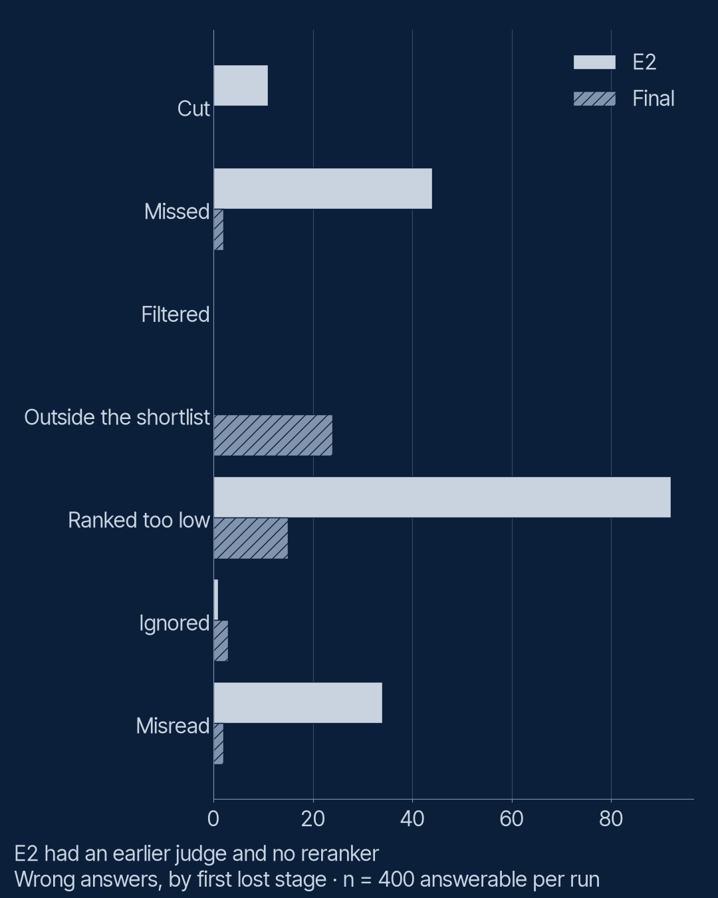

# S2 E14: Tracing a wrong answer

When the system gives a wrong answer, which stage caused it? E14 makes no call: it walks every
wrong answer in three reference runs back to the first stage that lost the right passage, in code,
from the retrieval log alone. Claims: [`PREREGISTRATION.md`](PREREGISTRATION.md).

**Result: the season cut wrong answers from 182 to 46, and what is left is mostly a ranking
problem that starts before the reranker.** All three claims held.

## The design

- **Runs:** E2's baseline (the naive system), E4's baseline (the same system, under the final
  judge) and the final reference system (`0294479ba987`, as run in E12), each on the 520 test
  items.
- **The diagnosis** (`first_lost_stage` in `src/lab/rag/score.py`, the slide function): for each
  wrong answer, the first of cut, missed by search, filtered, ranked out of the top 5, ignored
  (in the prompt, but the model declined) and misread (in the prompt, answer wrong). For the
  final system, ranking is split at the reranker's shortlist of 20: was the passage outside the
  shortlist, or did the reranker see it and still put it below 5?

## Results

| Wrong answers, by first lost stage | E2 | E4 | Final |
|---|---|---|---|
| Cut by the chunker | 11 | 13 | 0 |
| Missed by search (not in the top 50) | 44 | 39 | 2 |
| Removed by the filter | 0 | 0 | 0 |
| Outside the reranker's shortlist | | | 24 |
| Ranked too low | 92 | 86 | 15 |
| Ignored | 1 | 2 | 3 |
| Misread | 34 | 17 | 2 |
| **Wrong answers (of 400)** | **182** | **157** | **46** |
| Items with a leak (of 520) | 51 | 51 | 0 |



E2 used a different answer model and judge, so its "misread" count is not comparable; E4 is the
like-for-like start. From E4 to the final system:

- Structure chunking (E4) ended cut spans.
- Filtering before ranking (E8) ended leaks.
- The LLM reranker (E7) and the grounded prompt (E10) took most ranking and reading losses
  away.

## The claims

**T1 held: most ranking losses happen before the reranker.** 24 of the 39 wrong answers lost at
ranking had the right passage below 20th place after search, so the reranker never saw it. The
reranker can only reorder what search hands it.

**T2 held: the failures sit in follow-ups and identifiers.** 19 follow-ups and 14 identifier
questions make up 33 of 46 wrong answers. These are the two types E5 and E6 tried to fix
with hybrid search and follow-up resolution; neither met the strict joining rule.

**T3 held: when it answers a question it should decline, it is mostly a detail the library does
not have.** 9 of 13 are `absent_detail` items (the topic is covered, the detail is not); the
other 4 ask about restricted documents.

## Worked examples (final system)

- **Missed** (`IDENT-019`): "What is part KX-8033 for?" The article with the code is not in the
  top 50; vector search does not match exact codes well (E5). The model rightly says it could not
  find it.
- **Outside the shortlist** (`IDENT-005`): "What is part KX-3673 for?" The article ranks 39th,
  past the reranker's 20. The same failure, one stage later.
- **Ranked too low** (`FOLLOW-005`): "What about the Tessa dishwasher?" Searched as typed, the
  follow-up has lost its topic; the right article ranks 11th and the reranker moves it to 13th.
- **Ignored** (`SHARED-032`): a support article says the Mira has "a two-year warranty from
  purchase"; the warranty policy says 40 months from delivery. With both in the prompt, the
  model reports the conflict and declines to choose.
- **Misread** (`PARA-003`): the same conflict for the cooker hood; the model gives both periods
  and tells the customer to check.

Three of the five failures with the passage in the prompt are this same conflict (also
`FOLLOW-039`, the Vale fridge freezer): not model errors so much as a library that contradicts
itself, which the system faithfully reports. Tracing turns "the bot is wrong" into "these two documents disagree".

## What this does not show

- **The judge's verdicts are taken as given.** One example (`FOLLOW-005`) has the judge
  reasoning, wrongly, that the item was unanswerable; it still marked the answer wrong.
- **First lost is not the only cause.** A passage ranked too low might also have been misread.
- **Right answers with the passage lost** are not counted as failures.

## Run it

```bash
uv run python episodes/s2-e14-tracing/analyse.py
```
