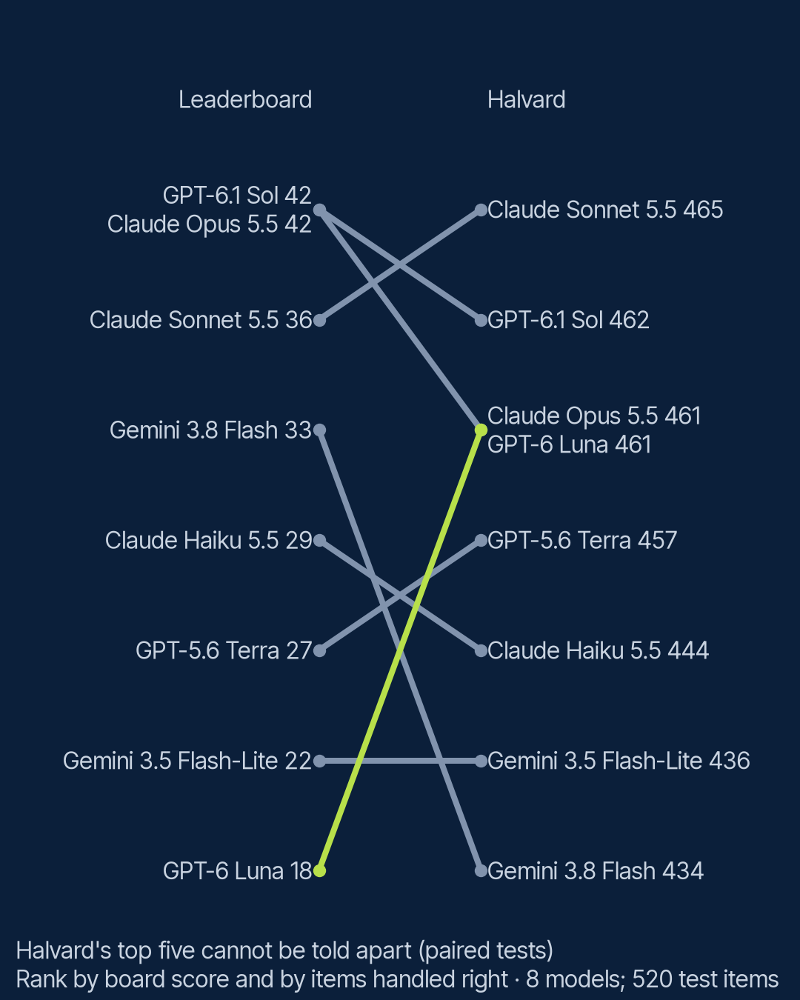

# S3 E3: Does the leaderboard predict your task? (field note)

Do public benchmark rankings hold on your own work? Eight answer models, ordered by the
Artificial Analysis Intelligence Index (read on 18 October 2026), each run through the Season 2
reference system on the same 520 test questions about Halvard Home (an invented appliance
maker). Only the answer model changes. Claims: [`PREREGISTRATION.md`](PREREGISTRATION.md).

**Result: on this task, the board's order did not predict ours.** Five models spanning 18 to 42
points on the board handled between 457 and 465 of 520 items right, and paired tests cannot
tell them apart. The cheapest model, `gpt-6-luna` (18 points), tied the board's two top models
(42 points); picking the board's top OpenAI model would have cost 21 times as much per item
handled right, and its top Anthropic model 84 times. All four claims held.

## The design

- **Board:** `leaderboard.yaml`: URL, read date, each model's score and the reasoning setting its
  row names. Scores copied, not rerun.
- **System:** the S2 reference system (`0294479ba987`): retrieval, reranker order, the
  `grounded_cite` instruction and the citation parser held fixed; only stage 9 changes.
- **Judges:** `gemini-3.6-flash` for OpenAI and Anthropic answers; `claude-sonnet-5-5` for the two
  Gemini models, so no model judges its own provider. Both judged a shared 100-item sample (see
  below).
- **Metric:** items handled right, out of 520: answerable questions answered right (judged
  correct and faithful, of 400) plus unanswerable questions declined (of 120).

## Results

| Model | Board (setting) | Handled right (of 520) | 95% interval | Right answers (of 400) | Declines (of 120) | Cost per item handled, x cheapest |
|---|---|---|---|---|---|---|
| `claude-sonnet-5-5` | 36 (low) | 465 | 86% to 92% | 355 | 110 | 36x |
| `gpt-6.1-sol` | 42 (low) | 462 | 86% to 91% | 359 | 103 | 21x |
| `claude-opus-5-5` | 42 (low) | 461 | 86% to 91% | 354 | 107 | 84x |
| `gpt-6-luna` | 18 (off) | 461 | 86% to 91% | 354 | 107 | 1x |
| `gpt-5.6-terra` | 27 (low) | 457 | 85% to 90% | 356 | 101 | 21x |
| `claude-haiku-5-5` | 29 (low) | 444 | 82% to 88% | 352 | 92 | 2x |
| `gemini-3.5-flash-lite` | 22 (minimal) | 436 | 80% to 87% | 332 | 104 | 3x |
| `gemini-3.8-flash` | 33 (low) | 434 | 80% to 86% | 326 | 108 | 8x |



**Tiers** (exact McNemar on all 28 pairs, Holm corrected): the top five cannot be told apart;
`claude-haiku-5-5` and the two Gemini models form a second tier. Cost covers the answer calls,
from provider-reported tokens and published prices on 18 October 2026.

**Behaviour that the totals hide:**

| Model | Median output tokens | Median seconds | Citations holding the evidence |
|---|---|---|---|
| `gpt-6-luna` | 28 | 1.2 | 91% |
| `gpt-6.1-sol` | 36 | 2.0 | 83% |
| `gpt-5.6-terra` | 30 | 1.1 | 88% |
| `claude-opus-5-5` | 318 | 3.7 | 50% |
| `claude-sonnet-5-5` | 155 | 2.1 | 63% |
| `claude-haiku-5-5` | 230 | 1.7 | 70% |
| `gemini-3.8-flash` | 25 | 1.5 | 81% |
| `gemini-3.5-flash-lite` | 24 | 0.5 | 87% |

The Claude models write longer answers and cite more passages per answer (Opus made 763
citations against `gpt-6-luna`'s 400), so a smaller share of their citations hold the evidence.
Every model cited something in at least 99% of its answers that were not declines.

## The claims

**B1 held: the board's order does not predict the Halvard order.** Kendall's tau-b 0.22, 95%
bootstrap interval from minus 0.07 to 0.47, which includes 0.

**B2 held: within a provider, the board's top model is not distinguishable from the cheapest.**
OpenAI: `gpt-6.1-sol` 462 against `gpt-6-luna` 461 (Holm p = 1.0). Anthropic: `claude-opus-5-5`
461 against `claude-haiku-5-5` 444 (p = 0.12). Google: `gemini-3.8-flash` 434 against
`gemini-3.5-flash-lite` 436 (p = 1.0). Three of three.

**B3 held: picking by the board costs several times more per item handled right.** The board's
top pick (`gpt-6.1-sol`, the higher scorer on Halvard of its two models at 42) cost 20.6 times
the best-value pick in Halvard's top tier, `gpt-6-luna`.

**B4 held: at least one pair is reversed.** `gemini-3.8-flash` sits 15 points above
`gpt-6-luna` on the board and handled 27 fewer items (Holm p = 0.001); it also sits 6 points
above `gpt-5.6-terra` and handled 23 fewer. Both reversals involve a Gemini model, which had a
different judge: see the first caveat below.

## What this means

On a grounded support task, where the answer is in the passages and the job is to read and cite
them, the board's general intelligence score said little about who would do best. The models
that did best were spread from top to bottom of the board, and the cheapest of them did as well
as the most expensive. A leaderboard is a reasonable shortlist; it is not the answer for your
task. A test set of your own questions is.

## What this does not show

- **Two judges.** The two Gemini models were judged by `claude-sonnet-5-5`, the rest by
  `gemini-3.6-flash`. On the shared 100-item sample from `gpt-6-luna`'s answers, the judges
  agreed on 97 of 100 declines, 96 of 100 correctness calls and 99 of 100 faithfulness calls, and
  Sonnet marked 2 fewer items handled right (88 against 90). The Gemini models trail the top tier
  by about 5 points, so the judge difference may explain part of their gap, not all of it:
  `gemini-3.8-flash` also declined more answerable questions (55 of 400, against 48 for
  `gpt-6-luna`). The code check, which reads key values without a judge, scores the Gemini
  models level with the rest (236 to 238 of 280 checkable items, against 235 to 246).
- **Lowest settings only.** The board's top rows (above 50 points) are models at high or maximum
  reasoning; none was run.
- **One task, one system, one date.** Claims cover the Halvard task only, not leaderboards in
  general. A rerun at a model release goes in a new dated folder beside `results/2026-10/`.
- **Different tokenizers.** Claude models report about 60% more input tokens for the same
  prompt; costs use each provider's own counts.

## Tokens

| | Input tokens | Output tokens |
|---|---|---|
| Estimate before the run (`lab rag estimate`, all eight arms; outputs at their 2,000-token limit, judge never cached) | about 28.9 million | up to about 14.9 million |
| Actual, answer calls made (six arms; `gpt-6-luna` and `gemini-3.5-flash-lite` came from cache) | 10.1 million | 467,000 |
| Actual, judge calls made, including the shared-sample check | 11.9 million | 204,000 |

The 32-item pilot per model came first and is in `results/2026-10/pilot/`. The run stopped once
when the Anthropic account ran out of credit and was resumed from the cache on 19 October 2026;
no call was repeated. Costs are published as ratios only.

## Run it

```bash
uv run lab rag analyse field-notes/s3-e3-leaderboard/config.yaml
```

```bash
uv run lab rag run field-notes/s3-e3-leaderboard/config.yaml
```

The first rebuilds the analysis and charts from committed results with no key; the second
reruns the experiment, with cached responses free.
