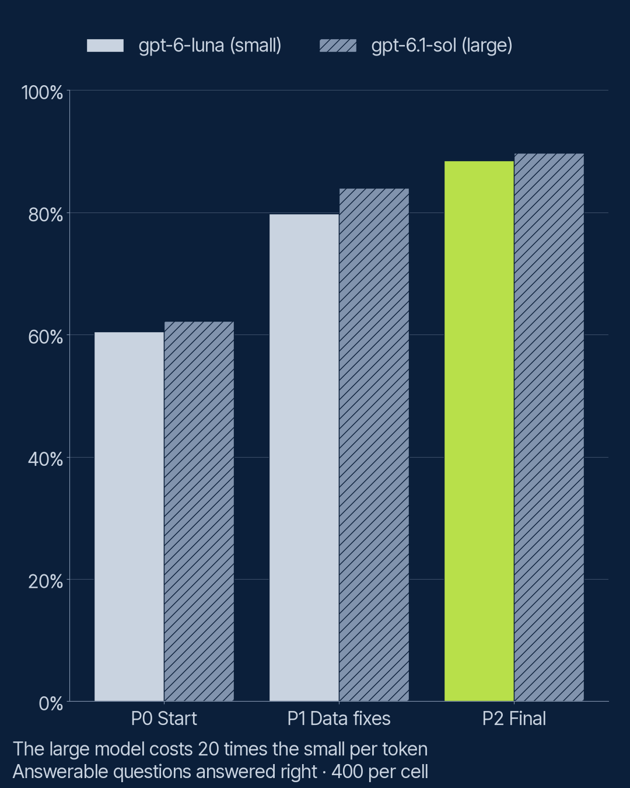

# S3 E7: Better data or a bigger model? (field note)

Does improving your own system beat paying for a bigger model? E7 crosses three versions of the
Season 2 support system with two sizes of answer model from one provider, on the same 520 test
questions about Halvard Home (an invented appliance maker). Claims:
[`PREREGISTRATION.md`](PREREGISTRATION.md).

**Result: fixing the data beat buying the bigger model, by a wide margin.** The small model on
the final system handled 461 of 520 items right; the large model on the naive system, 303. Data
work alone (section chunks and metadata filters) took the small model from 295 to 399. On the
final system the large model, at 20 times the price per token, added 1 item. All three claims
held, and the title rule keeps the title.

## The design

Three pipelines, each with `gpt-6-luna` (small, reasoning off) and `gpt-6.1-sol` (large, low
reasoning, its lowest setting), all judged by `gemini-3.6-flash`:

| Pipeline | What changes |
|---|---|
| P0 Start | S2's naive system: fixed 256-token windows, no filter, no reranker, plain instruction |
| P1 Data fixes | P0 plus section chunks (S2 E4) and access and version filters from document metadata (S2 E8) |
| P2 Final | P1 plus the LLM reranker, the grounded citing instruction and citation parsing: the S2 reference system |

Three cells came from cache, as pre-registered: P0 small (the S2 E4 baseline's answers), P2 small
(the S2 E12 reference run) and P2 large (S3 E3's `gpt-6.1-sol` arm). P0 large reused S2 E2's
answers and was judged again by the current judge.

## Results

| Cell | Right answers (of 400) | Correct declines (of 120) | Leaks (of 480 public) | Items handled right (of 520) | 95% interval |
|---|---|---|---|---|---|
| P0 small | 242 | 53 | 51 | 295 | 52% to 61% |
| P0 large | 249 | 54 | 51 | 303 | 54% to 62% |
| P1 small | 319 | 80 | 0 | 399 | 73% to 80% |
| P1 large | 336 | 83 | 0 | 419 | 77% to 84% |
| P2 small | 354 | 107 | 0 | 461 | 86% to 91% |
| P2 large | 359 | 103 | 0 | 462 | 86% to 91% |



**Leaks are structural, not a finding.** The filter removes staff-only passages before any model
reads the prompt, so both models leak the same 51 items on P0 and none on P1 or P2. A bigger
model cannot remove a leak.

**Cost per item handled right**, as a multiple of the cheapest cell (P0 small), counting the
answer calls and, on P2, the reranker's call:

| | Small | Large |
|---|---|---|
| P0 | 1x | 21x |
| P1 | 1.3x | 26x |
| P2 | 4.9x | 30x |

On P2 most of the small model's cost is the reranker, which reads 20 passages per question.

## The claims

**D1 held: the small model on the final system beat the large model on the naive one.** 461
against 303 of 520. Paired: 167 items right only on P2 small, 9 only on P0 large (exact McNemar
p below 0.001).

**D2 held: data work alone bought a real gain.** P1 small handled 399 against P0 small's 295:
123 items gained, 19 lost (p below 0.001). Right answers rose from 242 to 319 of 400, declines
from 53 to 80 of 120, and leaks fell from 51 to 0 of 480.

**D3 held: the bigger model added less on the better system.** It added 8 items on P0 and 1 on
P2. On P1 it added 20, its largest gain: with good passages but no reranker or citing
instruction, a stronger reader helps most.

**The title rule.** Data work alone (P0 to P1, small model) gave 104 of the 166 items the small
model gained from P0 to P2: 63%, above the pre-registered half. The title stays "Better data or
a bigger model?", with "better data" meaning section structure and document metadata.

## What this means

On this task, the order of spending is clear: structure and label the documents first, then
improve ranking and the prompt, and only then consider a bigger model, which at that point
added 1 item in 520 for 20 times the price per token. The large model's best showing was on the
half-finished system (P1), which is where a team that skipped the retrieval work would be.

## What this does not show

- **One provider's two sizes.** Other providers' large models may behave differently.
- **Reasoning differs:** the large model ran with low reasoning, the small with none; the large
  model cannot turn reasoning off.
- **P0 large's answers date from S2 E2 (12 October 2026);** the other new cells ran on 18
  October. The model versions returned were the same names throughout.
- **P0 small scored 242 of 400 here against 243 in S2 E4.** Judging is not perfectly repeatable:
  34 of its 520 judge calls were new requests in this run, and one verdict differed.
- **"Better data" is what the documents' own structure and metadata allow,** not every possible
  data improvement; cleaning contradictions out of the library (S2 E14) was not tested.

## Tokens and spend

| | Calls made | Input tokens | Output tokens |
|---|---|---|---|
| Actual, answers (P1 small and large; the rest cached) | 705 | 1,947,228 | 34,312 |
| Actual, judge | 1,217 | 3,034,395 | 64,372 |

The full-run estimate was not saved before the run; spend was approved from the pilot's
measured tokens (32 items per cell). `lab rag estimate` errs high by design: it counts every
output at the 2,000-token limit and treats every judge call as new. Costs are published as
ratios only.

## Run it

```bash
uv run lab rag analyse field-notes/s3-e7-data-or-model/config.yaml
```

```bash
uv run lab rag run field-notes/s3-e7-data-or-model/config.yaml
```

The first rebuilds the analysis and charts from the committed results, with no key. The second
reruns the experiment; cached responses cost nothing.
