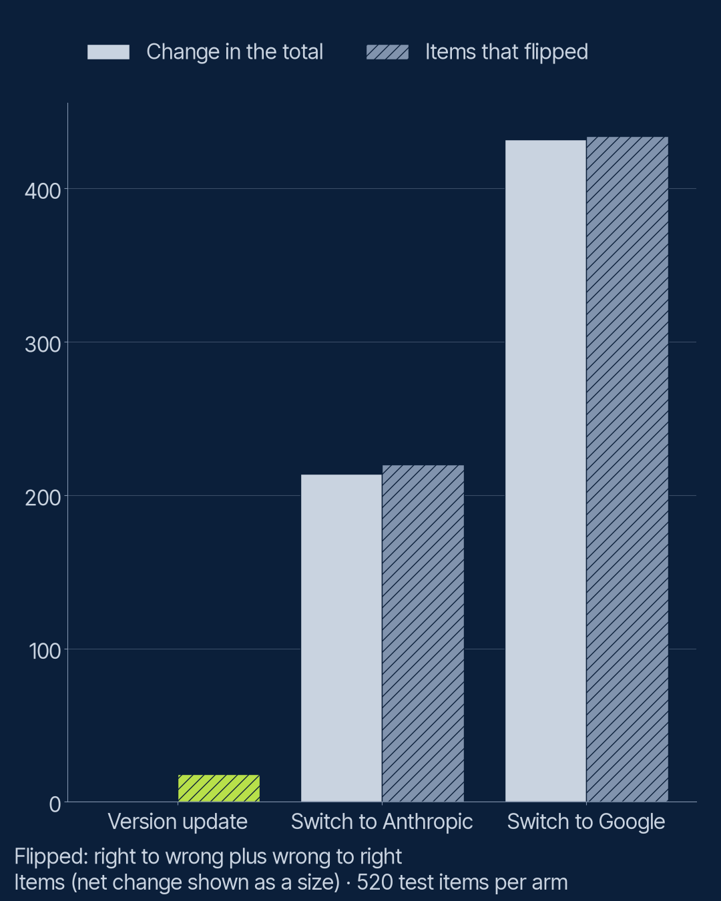

# S3 E9: Does it survive a model change? (field note)

What breaks when you switch provider, or when the provider updates the model under you? The
Season 2 reference system on the 520 test questions about Halvard Home (an invented appliance
maker), with only the answer model changing. Claims: [`PREREGISTRATION.md`](PREREGISTRATION.md).

**Result: the totals barely moved, but the answers did.** The version update left the total
exactly where it was (461 of 520 handled right) while 18 items changed between right and wrong.
The switch to Anthropic's cheapest tier moved the total by 5 items and changed 25. The prompt
and citation format carried across untouched; what changed was behaviour: Claude Haiku wrote
answers four times as long, citing more passages, fewer of which held the evidence. All four
claims held.

## The design

| Arm | Answer model | Setting | Judge |
|---|---|---|---|
| `baseline` | `gpt-6-luna`, today's system (S2 E12 reference run, from cache) | off | `gemini-3.6-flash` |
| `version` | `gpt-5.6-luna`, the previous version | off | `gemini-3.6-flash` |
| `provider` | `claude-haiku-5-5`, the same price tier at Anthropic | off | `gemini-3.6-flash` |
| `provider-google` | `gemini-3.5-flash-lite`, Google's nearest cheap tier | minimal | `claude-sonnet-5-5` |

The version arm reads as the update you did not choose: you were on `gpt-5.6-luna` and the
provider moved you to `gpt-6-luna`. Retrieval, the reranker's order, the `grounded_cite`
instruction word for word and the citation parser are held fixed.

## Results

| | Baseline | Version update | Switch to Anthropic | Switch to Google |
|---|---|---|---|---|
| **Content** | | | | |
| Items handled right (of 520) | 461 | 461 | 456 | 436 |
| Right answers (of 400) | 354 | 356 | 345 | 332 |
| Correct declines (of 120) | 107 | 105 | 111 | 104 |
| Items that flipped against the baseline | | 18 (9 each way) | 25 (15 lost, 10 gained) | 41 (33 lost, 8 gained) |
| Exact McNemar p | | 1.0 | 0.42 | 0.0001 |
| **Format** | | | | |
| Non-decline answers with a parseable citation | 365 of 365 | 371 of 371 | 363 of 363 | 364 of 367 |
| Declines worded so the code recognises "not found" | 146 of 155 | 149 of 149 | 147 of 157 | 147 of 153 |
| **Behaviour** | | | | |
| Citations holding the evidence | 365 of 400 (91%) | 370 of 424 (87%) | 375 of 525 (71%) | 364 of 418 (87%) |
| Median output tokens | 28 | 28 | 126 | 24 |
| Median seconds per answer | 1.2 | 1.2 | 1.2 | 0.5 |
| Errors, empty answers, refusals | 0 | 0 | 0 | 0 |
| Cost per item handled, x baseline | 1x | 2.1x | 1.8x | 3.4x |



## The claims

**V1 held: a total that barely moves hides many changed answers.** The version update: net
change 0, 18 items flipped. The switch to Anthropic: net change 5, 25 items flipped. Both at
least three times the net change.

**V2 held: the prompt carries across.** Every arm cited a passage in every answer that was not
a decline (Google 364 of 367), against the baseline's 365 of 365.

**V3 held: on the total, the swap looks safe.** Neither the version arm (p = 1.0) nor the
Anthropic arm (p = 0.42) is separated from the baseline by the paired test.

**V4 held: behaviour changes even when content does not.** Claude Haiku's median answer was 126
tokens against the baseline's 28, four and a half times as long. It cited 525 passages where
the baseline cited 400, and 71% of them held the evidence, against 91%.

`provider-google` was reported with no claim. It is the one swap a team would notice from the
total: 25 fewer items handled right (p = 0.0001), mostly right answers lost.

## What this means

Swapping a model, or having it swapped for you, is a change to test, not a configuration tweak.
The total is the wrong check: it can stay flat while one question in thirty changes its answer.
Rerun your own test set and compare it item by item, read the flipped items, and check behaviour
the total does not show (length, citations, cost), because that is what customers and reviewers
see.

## What this does not show

- **The reranker was held fixed** (`gpt-6-luna`). In practice teams often swap it too; only the
  answer model's change is measured here.
- **The Google arm had a different judge** (`claude-sonnet-5-5`). On a shared 100-item sample
  (S3 E3) it marked 2 fewer items handled right than `gemini-3.6-flash` did, so part of the
  Google arm's gap may be the judge.
- **The version arm is read backwards in time:** the older model stands in for the version you
  were on. A real forced update can also change behaviour this snapshot cannot show.
- **One system, one test set, one date** (`results/2026-10/`). A rerun at the next release goes
  in a new dated folder.

## Tokens

| | Calls made | Input tokens | Output tokens |
|---|---|---|---|
| Answer calls (version and Anthropic arms; the Google answers were made here and reused by E3) | 1,464 | 4,686,009 | 123,871 |
| Judge calls (version and Anthropic arms; the Google arm's verdicts came from E3's cache) | 923 | 2,821,203 | 48,315 |

The 32-item pilot came first (`results/2026-10/pilot/`). The run stopped once when the Anthropic
account ran out of credit and was resumed from the cache on 19 October 2026. The full-run
estimate was not saved before the run; spend was approved from the pilot's tokens. Costs are
published as ratios only.

## Run it

```bash
uv run lab rag analyse field-notes/s3-e9-model-change/config.yaml
```

```bash
uv run lab rag run field-notes/s3-e9-model-change/config.yaml
```
